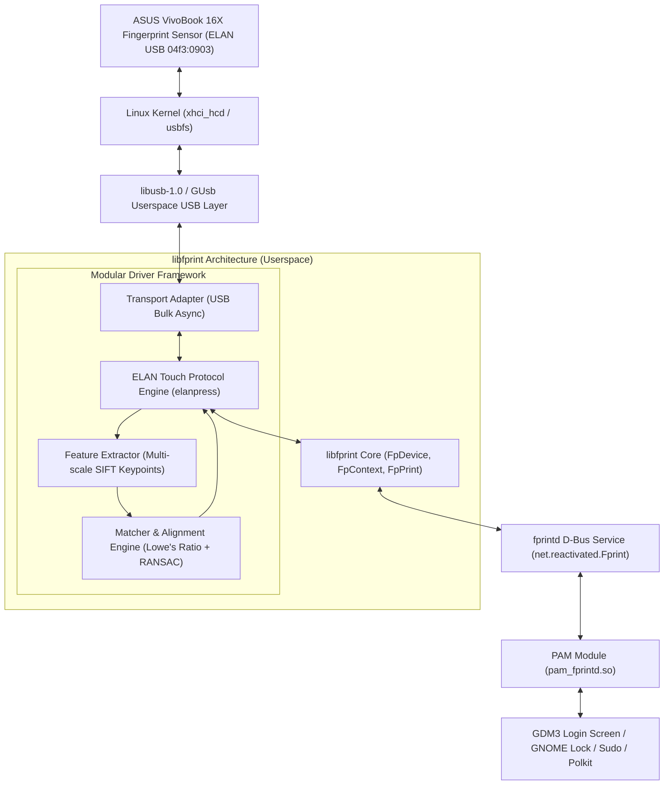

# Architecture Design: Universal Linux Touch Fingerprint Driver

## 1. System Architecture Overview

The driver integrates into the standard Linux biometric stack without requiring out-of-tree kernel modules or proprietary binary blobs. The complete stack flows as follows:

---

## 2. Module Responsibilities & Component Architecture

### 2.1 Transport Layer (`transports/`)
- Encapsulates asynchronous USB Bulk transfers using `FpiUsbTransfer` / `libusb-1.0`.
- Manages command pipeline:
  - Command Submission: Endpoint `0x01` (Bulk OUT).
  - Command Response: Endpoint `0x83` (Bulk IN).
  - High-Speed Frame Stream: Endpoint `0x82` (Bulk IN).
- Provides timeouts, error recovery, and cancellation hooks without hanging USB pipes.

### 2.2 Protocol Layer (`drivers/elanpress.c`, `drivers/elanpress.h`)
- Implements the `FpDevice` class lifecycle:
  - **Probe:** Detects VID `0x04f3` & PID `0x0903`.
  - **Open:** Initializes sensor, queries dimensions via `{0x00, 0x0c}`, reads firmware version via `{0x40, 0x19}`, and takes a baseline calibration/background frame.
  - **Touch Polling:** Paces frame acquisition via a lightweight 40ms polling loop, calculating pixel contrast against background reference.
  - **Touch Settlement:** Detects finger touchdown, waits 200ms (`ELANPRESS_SETTLE_MS`) for capacitive contact stabilization, and takes the sample.
  - **Touch Lift:** Enforces finger lift before allowing subsequent attempts.
  - **Close:** Issues `{0x00, 0x0b}` stop command and parks device in low-power idle.

### 2.3 Biometric Matcher & Alignment Engine (`drivers/elanpress-match.c`, `elanpress-sift.c`)
- **Multi-Touch Enrollment:** Collects 12 press samples (`ELANPRESS_ENROLL_STAGES = 12`) covering varying angles and parts of the fingertip, mirroring Windows Hello behavior.
- **Keypoint Extraction:** Computes local scale-invariant feature transform (SIFT) keypoint descriptors on the 2D capacitive ridge map.
- **Verification Matching:** 
  - Compares probe touch keypoints with enrolled prints using Lowe's nearest-neighbor distance ratio test (0.8).
  - Refines alignment through least-squares rigid geometric placement.
  - Rejects foreign fingers (score < 12 pairs) and verifies genuine fingers with high confidence (> 30 pairs).

---

## 3. Security Boundaries & Data Flow

1. **Least Privilege Principle:**
   - Raw hardware access is handled by `fprintd` running with system daemon privileges (`root`), communicating with the device node `/dev/bus/usb/001/002`.
   - User applications (e.g. desktop environment, `fprintd-enroll`, PAM) interact exclusively through D-Bus (`net.reactivated.Fprint`).
2. **Biometric Data Protection:**
   - Fingerprint print data is stored in `/var/lib/fprint/<user>` owned by `root:root` with `0600` permissions.
   - Raw images are not logged to disk or `journalctl`.
   - Only non-invertible feature descriptors and quality statistics are stored in serialized GVariant binary format.
3. **Authentication Safety & Password Fallback:**
   - PAM configuration (`/etc/pam.d/common-auth`) is structured with `[success=2 default=ignore] pam_fprintd.so` followed immediately by `pam_unix.so`.
   - If the biometric sensor is disconnected, fails, or times out, password authentication remains immediately functional.

---

## 4. Design Trade-offs & Upstream Considerations

| Architecture Choice | Alternative Considered | Rationale |
|---|---|---|
| **Userspace `libfprint` Driver** | Out-of-tree Linux Kernel Module | Kernel drivers are unnecessary for USB devices with userspace interfaces. Userspace drivers avoid kernel rebuilds, DKMS complexity, kernel panics, and security exposure. |
| **SIFT Keypoint Matching** | Standard NIST Minutiae (NBIS) | Small area capacitive sensors (96x96 pixels) do not yield sufficient minutiae for NBIS. Keypoint alignment reproduces Windows Hello accuracy and prevents the "swipe too short" flaw. |
| **In-Tree Driver Patch** | Standalone custom daemon | Directly updating `libfprint` leverages the entire existing Linux ecosystem (GNOME, GDM, SDDM, KDE, PAM, fprintd) seamlessly. |
